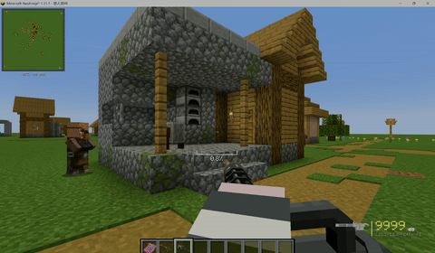

# [BD][BDur] Block Durability

给 Minecraft 方块增加耐久值，让枪械和爆炸可以逐步破坏它们。

<p align="center">
  <a href="assets/block-durability-demo.gif">
    
  </a>
</p>

## 爆炸耐久

v2.0.0 的主分支面向 Minecraft 1.21.1 NeoForge，重点加入了爆炸与方块耐久的联动：

- **TaCZ 爆炸物**：RPG、榴弹等原本只造成冲击、不破坏地形的爆炸，会按距离对范围内白名单方块追加耐久伤害。
- **原版及其他爆炸**：TNT、苦力怕等爆炸仍按原逻辑直接破坏方块；没有直接被炸碎的范围内白名单方块，会继续受到距离衰减的耐久伤害。
- **掩体遮挡**：爆炸到方块之间的实心碰撞体会阻挡耐久伤害，减少隔墙波及。
- **可配置**：爆炸伤害倍率、处理范围、原版爆炸兼容开关、方块 HP 和白名单都可以在服务端配置中调整。

> 只有加入白名单的方块才会受到这套耐久机制影响。实际破坏效果取决于方块硬度、HP 覆盖值、爆炸位置和配置倍率。

## 黑曜石也能被炸开

黑曜石不再必须依赖原版“炸不掉”的规则。它的耐久值由硬度公式计算，不需要手动写死 150：

```text
方块 HP = max(minBlockHP, 方块原版硬度 × hardnessMultiplier)
```

黑曜石的原版硬度是 `50`。把它加入白名单，并将 `hardnessMultiplier` 设为 `3.0`：

```toml
[whitelist]
blockWhitelist = [
    "minecraft:obsidian"
]

[hp_calculation]
minBlockHP = 1.0
hardnessMultiplier = 3.0
blockHPOverrides = []
```

代入公式后，黑曜石 HP 为 `max(1.0, 50 × 3.0) = 150`。在这样的耐久设置下，大约需要 **20～30 发机械动力火炮的高爆弹**才能击穿黑曜石。具体数量会受到命中位置、爆炸范围、伤害倍率和其他配置影响，可按服务器节奏继续调整。

## 兼容版本

| 分支 | Minecraft | 加载器 | 定位 |
| :--- | :--- | :--- | :--- |
| `master` | 1.21.1 | NeoForge | 当前主开发分支 |
| `forge-1.20.1` | 1.20.1 | MinecraftForge | 长期维护分支 |

主分支要求 NeoForge 21.1.80 或更高版本。[TaCZ](https://modrinth.com/mod/tacz-1.21.1) 为可选依赖；未安装时，模组仍可处理原版及其他模组的爆炸耐久。

## 基本配置

配置文件位于服务端 `config/blockdurability-common.toml`。常用项如下：

```toml
[general]
enabled = true
damagePerHit = 1.0
useBulletDamage = false
bulletDamageMultiplier = 1.0

[explosion]
enabled = true
damageMultiplier = 1.0
maxRadius = 16.0
handleVanillaExplosions = true

[healing]
healTimeoutSeconds = 120
```

- `damageMultiplier`：爆炸耐久伤害倍率。
- `maxRadius`：一次爆炸最多扫描的半径，用于限制大型爆炸的额外开销。
- `handleVanillaExplosions`：是否处理 TNT、苦力怕等非 TaCZ 爆炸。
- `healTimeoutSeconds`：受损方块停止受伤后恢复的时间，设为 `0` 可关闭自愈。

白名单支持方块 Tag、精确 ID 和 `*` 通配符：

```toml
[whitelist]
blockWhitelist = [
    "tag:minecraft:planks",
    "tag:minecraft:logs",
    "minecraft:obsidian",
    "minecraft:*glass"
]
```

方块最大 HP 默认按原版硬度计算。`blockHPOverrides` 只用于给个别方块指定固定值，正常情况下留空即可：

```toml
[hp_calculation]
hardnessMultiplier = 1.5
minBlockHP = 1.0
blockHPOverrides = []
```

如果确实需要覆盖某个方块的计算结果，可以按 `"minecraft:block_id=数值"` 的格式添加条目。

## 游戏内规则

管理员可以动态调整受损方块的恢复时间：

```text
/gamerule blockDurabilityHealSeconds <秒数>
```

例如 `/gamerule blockDurabilityHealSeconds 60` 表示 60 秒后恢复，设为 `0` 表示关闭自愈。

## 构建

需要 JDK 21：

```bash
./gradlew build
./gradlew test
```

构建产物位于 `build/libs/blockdurability-2.0.0-neoforge.jar`。

## 许可证

本项目基于 [MIT 许可证](LICENSE) 开源。
