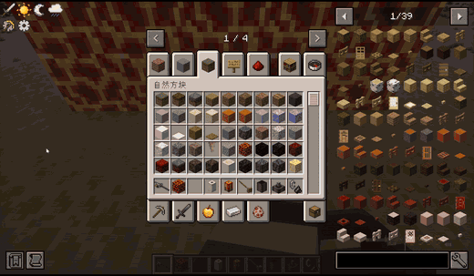
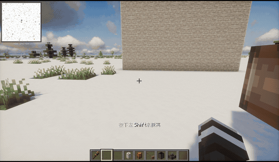
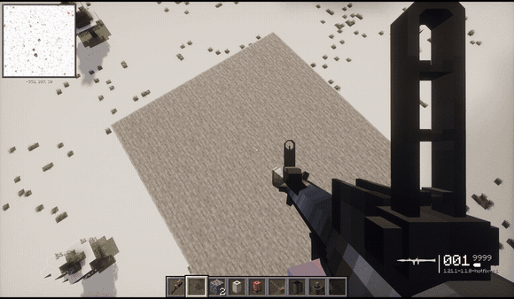
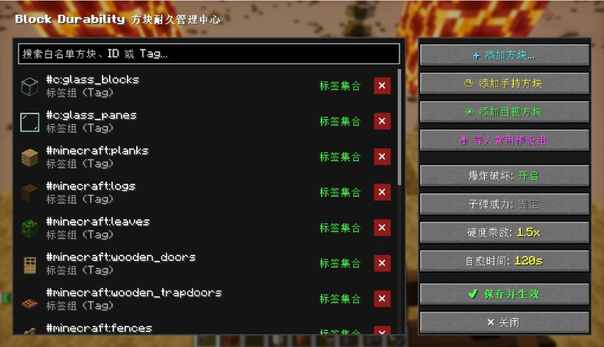

# [BD] Block Durability 方块耐久 (v2.1.1)

<p align="center">
  
  
  
  
</p>

<p align="center">
  <b>为 Minecraft 中的方块添加“耐久度”机制 —— 用枪械和爆炸逐层削减血量，直到方块崩解碎裂！</b><br>
  不再是简单的“能打/不能打”，破坏感与枪战沉浸感直接拉满。
</p>

---

## 🎬 效果演示 / Demo

<p align="center">
  
  <br>
  <i>（使用 TaCZ 枪械射击末地石方块，裂痕逐步加深直至碎裂摧毁）</i>
</p>

<table align="center">
  <tr>
    <td width="50%" align="center">
      
      <br><b>榴弹/火炮范围波及</b>
    </td>
    <td width="50%" align="center">
      
      <br><b>RPG 爆破拆楼</b>
    </td>
  </tr>
</table>

---

## 🌟 核心特性 / Features

### 1. 🎛️ 全新游戏内可视化方块管理中心 (仿 Advanced XRay 交互)
从 `v2.1.0` 起，彻底告别繁琐的手动编辑配置文件！游戏内输入 `/bd config` 即可呼出全中文、高清晰度的方块耐久管理中心：

<p align="center">
  
  <br>
  <i>（游戏内原生可视化管理面板：支持手持/目视方块一键捕获、全局检索与即时自动落盘）</i>
</p>
- ✋ **一键添加手持方块**：主手拿什么方块，点一下直接加入破坏白名单并即时落盘！
- 👁️ **一键添加目视方块**：准星对准视野内的任意方块，一键捕获并收录到白名单！
- 🔍 **全局方块检索浏览器**：内置 3D 图标预览与中英双语检索，从数千种方块中点选添加。
- ⚡ **即时自动保存 (Auto-Save)**：任何增删、预设导入、开关调整（真实威力/硬度乘数/自愈时间）以及关闭界面时，**全流程 100% 自动写盘**，重进世界或重启游戏绝不丢失！

> ⚠️ **关于单方块独立血量修改的特别说明**：  
> 当前游戏内 GUI 重点用于**白名单方块的高效增删**与**全局硬度乘数、自愈时间、真实威力等核心开关的调节**。界面列表中展示的方块耐久是根据 `硬度 × 全局乘数` 公式自动计算生成的；**目前在 GUI 中暂不支持直接点击某个方块单独设定该方块的独立 HP**。  
> 如需为特定个别方块单独指定固定 HP（例如将黑曜石固定设为 50 HP，而不受全局公式影响），请直接在配置文件 `config/blockdurability-common.toml` 的 `blockHPOverrides` 中添加（例如 `"minecraft:obsidian=50"`）。单方块独立数值的界面编辑计划在后续版本加入。

### 2. 🔫 真实子弹威力 & 阶梯式裂纹破坏
- **真实威力模式**：支持按 TaCZ 子弹的实体伤害倍率削减方块血量（反器材重狙穿墙碎石、手枪逐步磨血）。
- **固定点射模式**：每发子弹固定扣除指定耐久值，适合对战防守平衡。
- **阶段性裂痕**：伴随受损进度同步呈现原版 0~9 级递进破坏裂纹与粒子音效。

### 3. 💥 爆炸耐久联动
- **TaCZ 爆炸武器**：RPG、高爆榴弹对爆炸范围内的白名单方块按距离产生真实耐久波及衰减。
- **原版及模组爆炸**：平滑兼容 TNT、苦力怕爆炸。未被瞬间秒杀的方块将继续受到耐久冲击波伤害。
- **防隔墙穿透**：爆炸与方块之间的实心障碍体会有效遮挡伤害，掩体更真实。

### 4. 🧠 智能硬度公式 & 全模组标签 (Tag) 兼容
方块耐久默认按原版破坏硬度自动计算，无须手动配置繁琐数值：
```text
方块 HP = max(最低血量, 方块硬度 × 硬度乘数)
```
- 原生支持 `tag:minecraft:planks`、`tag:c:glass_blocks` 等标签匹配，自动向下兼容几乎所有模组的新方块！
- 亦支持精确 ID（如 `minecraft:end_stone`）与通配符（如 `minecraft:*glass*`）。
- 黑曜石（硬度 50）在乘数 3.0 下 HP 达到 150，需要数十发炮弹或重型狙击枪连续射击方可击穿！

### 5. ⏳ 超时自愈与内存安全
- 受损未碎的方块在设定的闲置时间（默认 120 秒）后会自动清除裂纹、自愈回满血量并回收内存。
- 管理员可在游戏内通过原版指令随时动态调整：
  ```text
  /gamerule blockDurabilityHealSeconds <秒数>
  ```
  *(设为 `0` 则彻底关闭自愈机制)*

---

## 🎮 游戏内指令 / Commands

| 指令 | 权限 | 说明 |
| :--- | :--- | :--- |
| `/bd config` 或 `/blockdurability config` | 所有人 | 打开游戏内方块耐久可视化管理中心 |
| `/bd` 或 `/blockdurability` | 所有人 | 快捷打开管理中心 |
| `/gamerule blockDurabilityHealSeconds <秒数>` | 管理员 (OP) | 调整受损方块的自愈倒计时（默认 120 秒） |

---

## 📦 兼容版本与分支 / Compatibility

| 分支 / 分发 | Minecraft 版本 | 模组加载器 | 兼容 TaCZ 状态 | 定位 |
| :--- | :--- | :--- | :--- | :--- |
| `master` | **1.21.1** | **NeoForge** (21.1.80+) | **TaCZ 1.2.0 官方正式版** 及以上 | 主开发分支 / 最新特性 |
| `forge-1.20.1` | **1.20.1** | **MinecraftForge** (47.1.0+) | **TaCZ 1.0.2+（含 1.2.0 及以上）** | 长期稳定维护分支 |

> 💡 **提示**：TaCZ 为可选依赖，未安装 TaCZ 时本模组依然可以独立接管原版 TNT/苦力怕的爆炸耐久机制！

---

## ⚙️ 配置文件说明 (`blockdurability-common.toml`)

文件位于客户端/服务端的 `config/blockdurability-common.toml`，在游戏中通过可视化面板修改会自动实时同步更新：

```toml
[general]
    enabled = true                    # 启用方块耐久系统
    useBulletDamage = false           # 是否启用真实子弹威力（true: 按枪械真实威力; false: 固定点射伤害）
    damagePerHit = 1.0                # 固定模式下每枪造成的伤害
    bulletDamageMultiplier = 1.0      # 真实威力模式下的全局伤害乘数
    healTimeoutSeconds = 120          # 自愈闲置时间（秒），设为 0 关闭

[hp_calculation]
    hardnessMultiplier = 1.5          # 硬度乘数：HP = 硬度 * 该倍率
    minBlockHP = 1.0                  # 方块最低血量兜底
    # 单独指定特定方块的固定 HP（优先级高于硬度公式，格式："modid:block_id=血量"，支持通配符）
    # 默认留空；示例："minecraft:obsidian=50.0", "minecraft:*glass*=1.0"
    blockHPOverrides = []

[explosion]
    enabled = true                    # 启用爆炸耐久波及机制
    damageMultiplier = 1.0            # 爆炸伤害乘数
    maxRadius = 16.0                  # 最大扫描半径（安全限制）
    handleVanillaExplosions = true    # 是否接管原版 TNT、苦力怕等爆炸

[whitelist]
    # 破坏白名单（支持 tag:、精确 ID、通配符）
    blockWhitelist = [
        "tag:c:glass_blocks",
        "tag:c:glass_panes",
        "tag:minecraft:planks",
        "tag:minecraft:logs",
        "tag:minecraft:leaves",
        "tag:minecraft:wooden_doors",
        "tag:minecraft:wooden_trapdoors",
        "tag:minecraft:fences",
        "tag:minecraft:fence_gates",
        "tag:minecraft:wooden_stairs",
        "tag:minecraft:wooden_slabs",
        "tag:minecraft:wooden_buttons",
        "tag:minecraft:wooden_pressure_plates",
        "tag:minecraft:standing_signs",
        "tag:minecraft:wall_signs",
        "tag:minecraft:ceiling_hanging_signs",
        "tag:minecraft:wall_hanging_signs"
    ]
```

---

## 📄 开源许可 / License
本项目采用 [MIT 许可证](LICENSE) 开源，欢迎在整合包中随意免费使用与传播！
