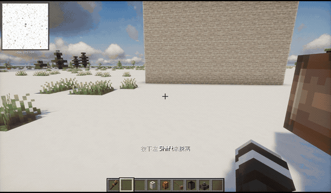

# [BD][BDur] Block Durability (v2.0.0)

给 Minecraft 方块加上耐久值——用枪械与爆炸打碎它们！

<p align="center">
  
</p>
<p align="center">
  <a href="assets/block-durability-demo.gif">
    
  </a>
</p>

---

## 🚀 v2.0.0 重大更新日志 (What's New in v2.0.0)

> v2.0.0 是一次里程碑式的架构重构与特性飞跃，彻底解除了与 TaCZ 的硬绑定，全面引入了双轨制爆炸破坏系统，并消除了旧版所有的生命周期隐患：

1. **💥 混合双轨制爆炸破坏（全新核心系统）**：
   - **原版 TNT / 苦力怕等爆炸**：内圈威力区正常炸碎方块；外圈未能炸碎的高防爆方块，自动转入**基于距离线性衰减的耐久扣血**！
   - **TaCZ 爆炸武器全面接管**：TaCZ 的 RPG、榴弹等默认不破坏地形（`KEEP` 模式），在 Block Durability 接管下，范围内所有白名单方块**全自动享受范围破拆扣血**！
   - **物理视线遮挡（Raycast Occlusion）**：冲击波受实体掩体阻隔，躲在防爆掩体后的玻璃窗安全无恙，杜绝隔墙炸毁。
2. **🛡️ TaCZ 独立解耦与纯净运行（Standalone Addon）**：
   - 枪械命中监听独立封装为软依赖；未安装 TaCZ 时模组可作为**独立的原版/通用模组爆炸耐久 Addon** 稳定运行，绝不抛出任何类加载异常。
3. **🪵 彻底摆脱 Mixin（零注入、零侵入）**：
   - 完全删除旧版 `MixinBlockRayTrace`，改为官方标准数据包标签覆盖（覆写 TaCZ 的 `bullet_ignore` 标签并移除栅栏和栅栏门）。
   - 彻底消除了不同 TaCZ 衍生构建版本（Reforged / Renovated 等）下的启动冲突崩溃隐患。
4. **⏱️ 120 秒超时自愈与 GameRule 动态调整**：
   - 残血方块未受伤害超时自愈时间提升至 **120 秒**。
   - 新增游戏内管理员指令：`/gamerule blockDurabilityHealSeconds <秒数>`（支持随时动态调节，设为 `0` 则彻底关闭自愈）。
5. **🧹 方块破坏与放置全生命周期闭环（解决幽灵裂纹）**：
   - 新增监听原版方块破坏（`BreakEvent`）与放置（`EntityPlaceEvent`），以及心跳空气检测。
   - 彻底解决了方块被玩家手动挖除或水冲推走后，原地放置新方块“继承旧裂纹/秒碎”的幽灵进度 Bug。
6. **🤝 领地保护生态友好（Claim Protection）**：
   - 命中事件监听优先级调整至 `EventPriority.LOWEST`，尊重领地、地皮、FTB Chunks 等圈地防破坏拦截。
7. **⚡ 配置热重载与线程安全正则缓存**：
   - 白名单通配符正则编译并加入缓存，在配置重载（`ModConfigEvent.Reloading`）时自动刷新缓存，杜绝非法数值/NaN 崩溃。

---

## 🌿 Git 分支与多版本架构

Block Durability 采用多分支结构维护不同 Minecraft 与模组加载器版本：

| 分支名 | 目标游戏版本 | 模组加载器 | 分支定位 | 对应依赖 |
| :--- | :--- | :--- | :--- | :--- |
| **`master`** | **Minecraft 1.21.1** | **NeoForge** (>= 21.1.80) | **主开发分支（默认）** | TaCZ 1.1.6 ~ 1.1.8+（可选） |
| **`forge-1.20.1`** | Minecraft 1.20.1 | MinecraftForge (>= 47.3.0) | 移植与长期维护分支 | TaCZ 1.0.2 ~ 1.1.8+（可选） |
| **`neoforge-1.21.11`** | Minecraft 1.21.11 | NeoForge (>= 21.11.48) | 社区 CalVer 前瞻分支 | TaCZ 1.21.11 移植版（可选） |

---

## 依赖与运行环境

- **运行平台**：NeoForge 1.21.1 (推荐 NeoForge 21.1.80 或更高版本)
- **可选依赖**：[TaCZ](https://modrinth.com/mod/tacz-1.21.1) (Timeless & Classics Guns: Zero, NeoForge 移植版) 1.1.6 - 1.1.8+
  > **独立运行说明**：TaCZ 为可选软依赖。若未安装 TaCZ，Block Durability 可作为纯净的原版/模组**爆炸范围耐久 Addon** 独立运行。

---

## 默认支持的方块类型

| 类别 | 格式 / Tag / ID |
|---|---|
| 玻璃与玻璃板 | `tag:c:glass_blocks`, `tag:c:glass_panes` |
| 木板、原木与树叶 | `tag:minecraft:planks`, `tag:minecraft:logs`, `tag:minecraft:leaves` |
| 木门与木活板门 | `tag:minecraft:wooden_doors`, `tag:minecraft:wooden_trapdoors` |
| 栅栏与栅栏门 | `tag:minecraft:fences`, `tag:minecraft:fence_gates` |
| 楼梯、台阶与红石配件 | `tag:minecraft:wooden_stairs`, `tag:minecraft:wooden_slabs`, `tag:minecraft:wooden_buttons`, `tag:minecraft:wooden_pressure_plates` |
| 告示牌与吊挂告示牌 | `tag:minecraft:standing_signs`, `tag:minecraft:ceiling_hanging_signs` 等 |
| 地表与基础方块 | 可在配置中随意追加，如 `minecraft:grass_block`, `minecraft:dirt`, `minecraft:stone`, `minecraft:cobblestone`, `minecraft:obsidian` 等 |

---

## 配置文件说明

配置文件位于服务端的 `config/blockdurability-common.toml`：

```toml
[general]
    # 是否启用模组功能
    enabled = true
    # 每发子弹命中的固定伤害值
    damagePerHit = 1.0
    # 是否使用 TaCZ 子弹实体的真实伤害数值（设为 true 时 damagePerHit 失效）
    useBulletDamage = false
    # 子弹伤害倍率
    bulletDamageMultiplier = 1.0

[whitelist]
    # 允许被枪械与爆炸破坏的方块列表
    # 支持三种格式：
    #   1. tag: 前缀（如 "tag:minecraft:planks"，推荐，自动兼容其他模组木头）
    #   2. 精确方块 ID（如 "minecraft:grass_block"）
    #   3. 通配符模式（如 "minecraft:*stained_glass"）
    blockWhitelist = [
        "tag:c:glass_blocks",
        "tag:c:glass_panes",
        "tag:minecraft:planks",
        "tag:minecraft:logs",
        "tag:minecraft:leaves",
        "tag:minecraft:wooden_doors",
        "tag:minecraft:wooden_trapdoors",
        "tag:minecraft:fences",
        "tag:minecraft:fence_gates",
        "tag:minecraft:wooden_stairs",
        "tag:minecraft:wooden_slabs",
        "tag:minecraft:wooden_buttons",
        "tag:minecraft:wooden_pressure_plates",
        "tag:minecraft:standing_signs",
        "tag:minecraft:wall_signs",
        "tag:minecraft:ceiling_hanging_signs",
        "tag:minecraft:wall_hanging_signs"
    ]

[hp_calculation]
    # 方块血量计算公式：HP = max(minBlockHP, 方块原版硬度 * hardnessMultiplier)
    hardnessMultiplier = 1.5
    # 方块最低血量保底
    minBlockHP = 1.0
    # 手动指定特定方块的固定血量覆盖，优先级最高（格式：["minecraft:obsidian=50.0"]）
    blockHPOverrides = []

[explosion]
    # 是否启用爆炸范围耐久伤害
    enabled = true
    # 爆炸耐久伤害倍率
    damageMultiplier = 1.0
    # 爆炸扫描半径上限（米），防止超大爆炸卡顿
    maxRadius = 16.0
    # 是否接管原版 TNT/苦力怕未炸毁方块的波及扣血
    handleVanillaExplosions = true

[healing]
    # 受损方块未继续受损时的自愈冷却时间（秒，0 代表完全禁用自愈）
    # 游戏内亦可通过 /gamerule blockDurabilityHealSeconds 动态调整
    healTimeoutSeconds = 120

[effects]
    # 方块碎裂时是否生成破坏粒子
    spawnBreakParticles = true
    # 方块受损与崩解时是否播放音效
    playBreakSound = true
    # 方块被枪械/爆炸打碎后是否掉落物品
    dropItems = false
```

---

## 游戏内指令

- **修改自动恢复冷却秒数**：
  ```
  /gamerule blockDurabilityHealSeconds <秒数>
  ```
  *例：`/gamerule blockDurabilityHealSeconds 60`（设为 60 秒）；设为 `0` 代表彻底禁用自愈。*

---

## 构建与测试

需要 JDK 21 环境：

```bash
# 构建 JAR
./gradlew build

# 运行自动化单元测试
./gradlew test
```

构建产物位于 `build/libs/blockdurability-2.0.0-neoforge.jar`。

---

## 📜 许可证

本项目基于 [MIT 许可证](LICENSE) 开源。
